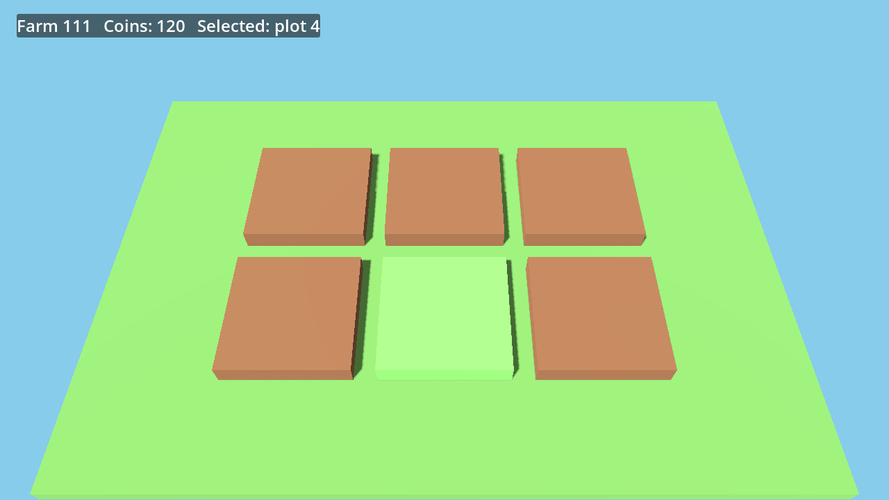
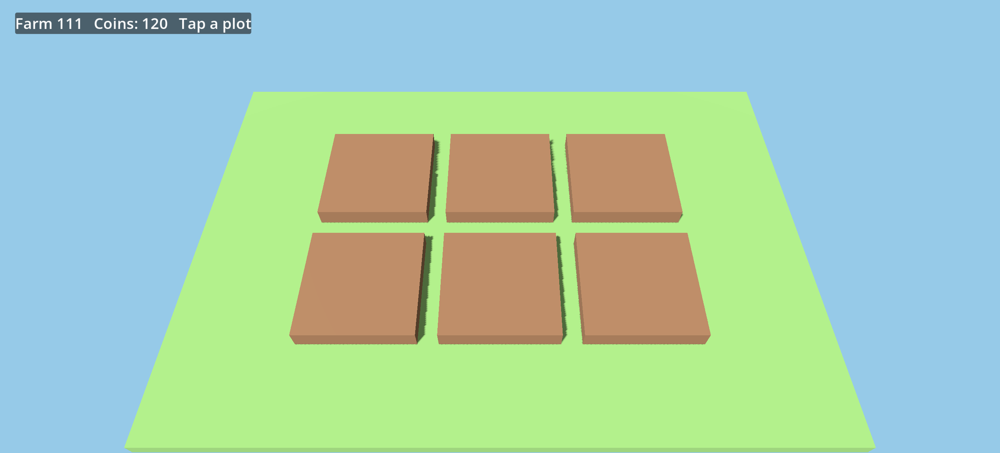
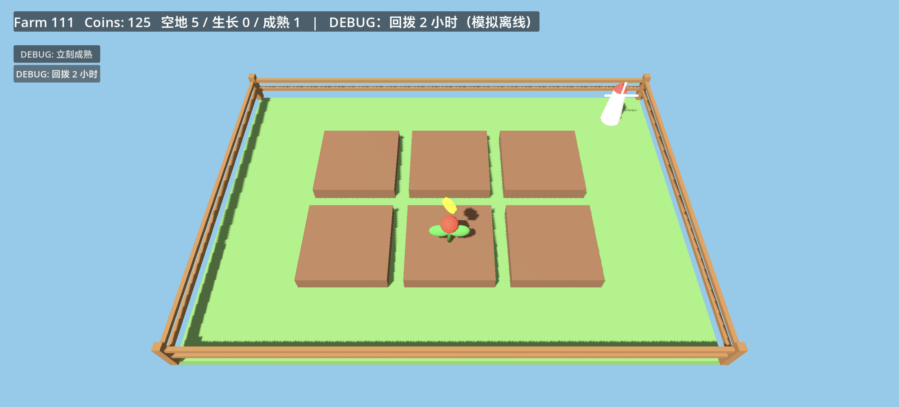
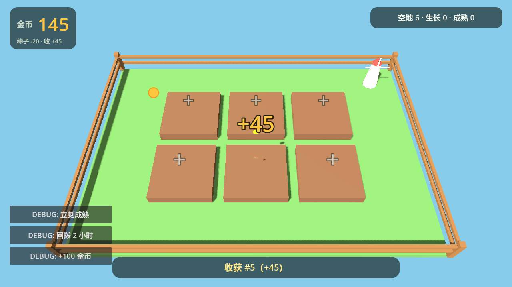
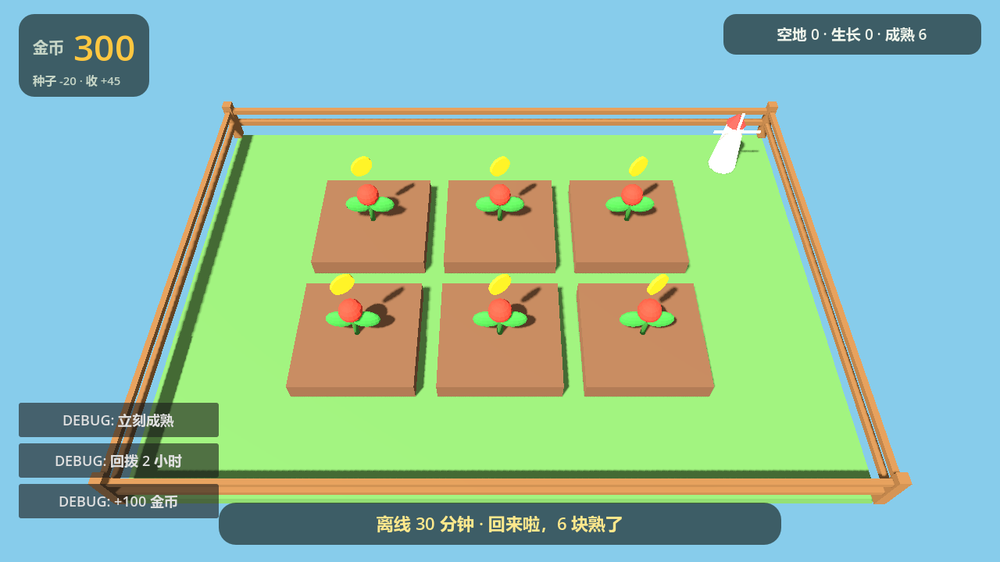
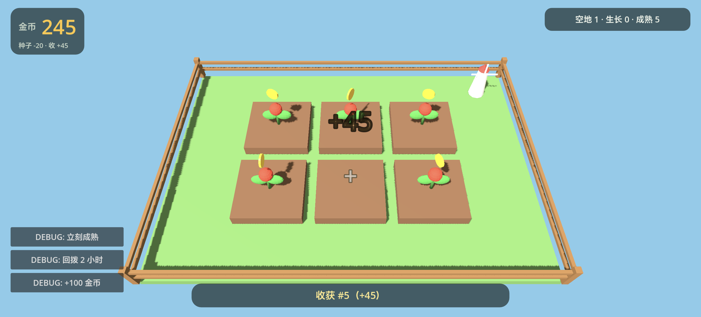
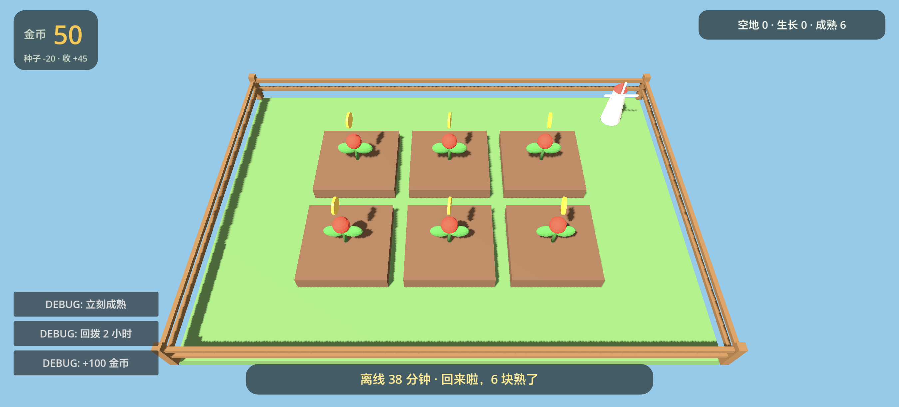
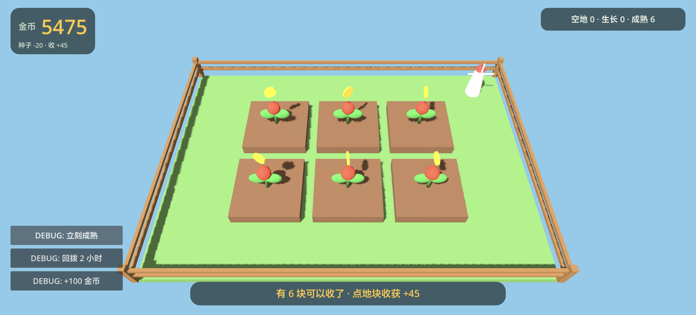

# 111 · 小农场

一个安卓 APK 小游戏：Godot 4.7.2 做的 3D 低模农场，横屏、纯单机。

**状态（2026-11-05）**：M1、M2 已真机验收并关闭；M3「打磨与验收」的实现、桌面验收与**真机连续 5 分钟稳定性**都已通过，只剩把 APK 发给朋友收一条反馈（[#3](https://github.com/000saber000/111/issues/3)）。

## 这是什么

6 块地，点空地种下（-20），等 10 分钟成熟，点成熟作物收获（+45），金币再买种子；关掉游戏再回来按时间戳结算离线生长（封顶 8 小时）。目标是自己手机能装、能完整玩一局，练手用。

- **引擎**：Godot 4.7.2（GL Compatibility 渲染，Android arm64-v8a，debug 签名侧载）
- **时间**：无服务器、无联网，全部靠本机时间戳与 `user://save.json` 存档
- **规模**：一个人能完整维护的量级
- **同时是本仓库协作约定的落脚点**（issue tracker、标签词汇、域文档布局，见 [约定](#约定)）

## 这不是什么

- 不联网：无账号、云同步、排行榜
- 不枯萎、没有失败状态
- 不上架、不做正式 keystore；只侧载给自己和朋友
- 不做人物模型、骨骼动画、多语言、存档导入导出

## 目录结构

```
/
├── AGENTS.md              ← agent 读的仓库配置入口（issue tracker / 标签 / 域文档路径）
├── README.md
├── .gitignore             ← 通用条目 + Godot（.godot/、build/、*.apk）
├── project.godot          ← Godot 工程入口（横屏、图标、ETC2/ASTC）
├── export_presets.cfg     ← Android 导出配置（debug 签名 + 启动图标）
├── scenes/main.tscn       ← 主场景；世界在 scripts/main.gd 里用代码搭
├── scripts/
│   ├── main.gd            ← 相机 / 6 地块 / 点选 / HUD / 反馈动效 / 音效
│   ├── farm_logic.gd      ← 纯规则（种植 / 收获 / 生长 / 离线结算），可无头测试
│   ├── balance.gd         ← 全部数值（成熟时间、价格、初始金币…）
│   └── save_manager.gd    ← 原子写存档（tmp → rename，保留 .bak）
├── tests/run_tests.gd     ← farm_logic 的无头测试（36 条断言）
├── assets/
│   ├── models/            ← 8 个低模 .glb（Blender 脚本生成）
│   ├── audio/             ← 种植 / 收获 / 金币 三个 wav（Python 合成）
│   └── icon/              ← 应用图标 + Android 自适应图标前后景
├── tools/
│   ├── blender/generate_assets.py  ← 8 个 .glb
│   ├── audio/generate_sfx.py       ← 3 个音效
│   └── icon/generate_icon.py       ← 图标（Pillow）
├── build/                 ← APK 与截图，已 gitignore
└── docs/                  ← spec.md、里程碑交接文档、截图、agents/ 配置
```

## 约定

### Issue

工作项都开在 GitHub Issues，用 `gh` 管理，不另建 TODO 文件。建票、读票、父子票、阻塞边的写法见 [`docs/agents/issue-tracker.md`](docs/agents/issue-tracker.md)。

### 标签

分流只用五个角色标签：`needs-triage`、`needs-info`、`ready-for-agent`、`ready-for-human`、`wontfix`，字符串与角色同名。探索地图及其子票只带 `wayfinder:*` 标签（`map` / `research` / `prototype` / `grilling` / `task`），不混入分流标签。映射见 [`docs/agents/triage-labels.md`](docs/agents/triage-labels.md)。

### 域文档

本仓库按 **multi-context** 布局记录领域词汇：根目录 `GLOSSARY-MAP.md` 指向各上下文自己的 `GLOSSARY.md`，系统级架构决策放 `docs/adr/`。这两个文件现在都还不存在，留给第一次真正写下词条时由 `/domain-modeling` 创建。消费规则见 [`docs/agents/domain.md`](docs/agents/domain.md)。

## 里程碑

玩法、引擎、数值、资产、存档、里程碑已经定死在 [`docs/spec.md`](docs/spec.md)（一次完整 grill 的结论）。按三个里程碑顺序推进，**不绑日期**——里程碑是门槛，不是期限：

1. ✅ [#1 M1 端上跑通](https://github.com/000saber000/111/issues/1)：Godot 工程 + 6 地块 + 点选 + 导出 APK 装机
2. ✅ [#2 M2 闭环打通](https://github.com/000saber000/111/issues/2)：种植/生长/收获/金币 + 离线结算 + 8 个资产
3. ⏳ [#3 M3 打磨与验收](https://github.com/000saber000/111/issues/3)：音效/反馈/横屏 UI/图标已实现，真机 5 分钟稳定性已通过；待朋友试玩反馈

## 本地开发

**环境**（都在这台机器的 D 盘，C 盘只用到你原有的 Android SDK）：

- Godot 4.7.2：`D:\Godot\Godot_v4.7.2-stable_win64.exe`（自包含模式，配置与导出模板在 `D:\Godot\editor_data`，不写 C 盘 AppData）
- Android SDK：`C:\Users\rongyao\AppData\Local\Android\Sdk`（导出用 build-tools 36.1.0）
- debug keystore：`D:\Godot\android\debug.keystore`（`storepass` / `keypass` 均为 `android`）

**打开工程**：用上面的 Godot 直接打开本目录。

**桌面跑**：

```bash
"D:\Godot\Godot_v4.7.2-stable_win64.exe" --path .
```

**无头测试**（farm_logic 的规则与离线结算）：

```bash
"D:\Godot\Godot_v4.7.2-stable_win64_console.exe" --headless --path . --script res://tests/run_tests.gd
```

**无人值守截图 / 演示**（桌面上跑，截完自动退出；不会改存档）：

```bash
# 截一张图就退出
"...Godot_v4.7.2-stable_win64_console.exe" --path . -- --shot=res://build/shot.png
# 新档 + 摆好场景再截图：plant / growing / mature / harvest
"...Godot_v4.7.2-stable_win64_console.exe" --path . -- \
  --fresh --mute --demo=harvest --shot=res://build/harvest.png --shot-frame=12
```

其它调试参数：`--tap=x,y` 模拟点击、`--mature` 把生长中的地直接判成熟、`--mute` 静音。

**重新生成资产**：

```bash
"D:\Blender\blender.exe" --background --factory-startup --python tools/blender/generate_assets.py
python tools/audio/generate_sfx.py
python tools/icon/generate_icon.py
```

**导出 APK**：

```bash
"D:\Godot\Godot_v4.7.2-stable_win64_console.exe" --headless --path . --export-debug "Android" build/xiaonongchang.apk
```

> 导出时 Godot 会调 `keytool` / `apksigner` 子进程。在受限沙箱里会报 `CreatePipe ... ERR_CANT_FORK`，用普通终端或放宽权限再跑。

**装到手机**（手机先开 USB / 无线调试并连上）：

```bash
"C:\Users\rongyao\AppData\Local\Android\Sdk\platform-tools\adb.exe" install -r build/xiaonongchang.apk
```

**存档位置**：手机上是应用私有目录；桌面调试时在 `%APPDATA%\Godot\app_userdata\小农场\save.json`。

## 截图











