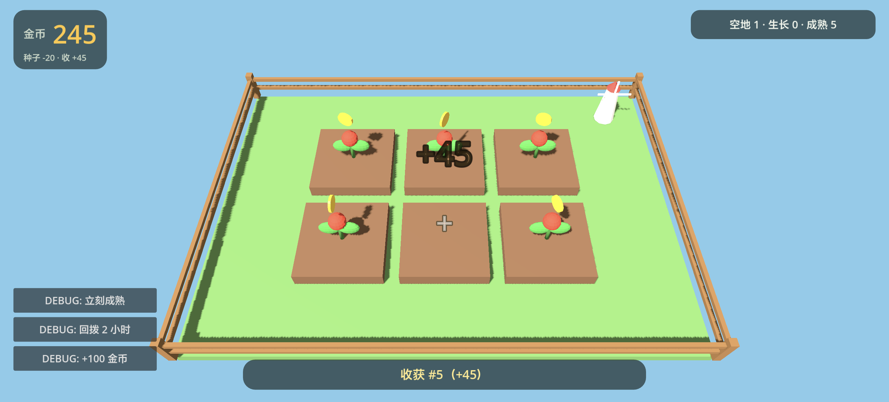
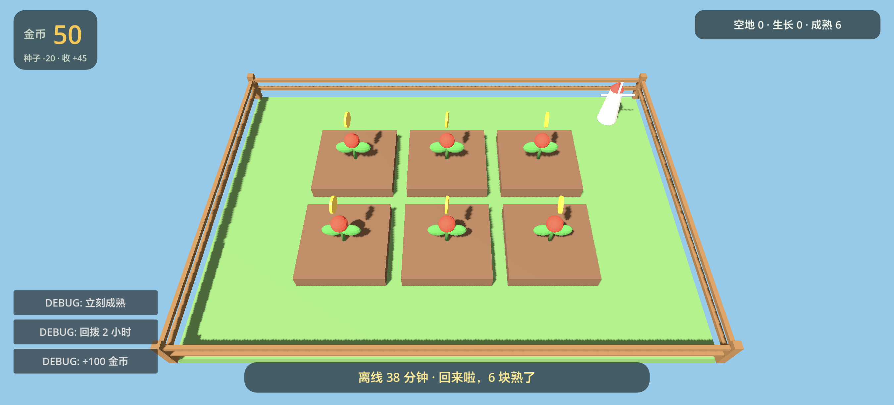

# 小农场 v0.1.0 · M3 打磨版

一个 Godot 4.7.2 做的 3D 低模农场安卓小游戏：6 块地，点空地种下（−20 金币），等 10 分钟成熟，点成熟作物收获（+45），金币再买种子；关掉游戏回来按时间戳结算离线生长。纯单机、不联网，练手项目。

## 下载与安装

- **[小农场 v0.1.0（debug APK）](https://github.com/000saber000/111/releases/download/v0.1.0/xiaonongchang-v0.1.0-m3-debug.apk)** —— 约 28.6 MB
- 系统要求：Android 7.0+（minSdk 24），arm64 手机（arm64-v8a）
- 安装：手机上允许「安装未知来源应用」后直接侧载；debug 签名，不上架
- 存档只在本机（应用私有目录），卸载即清

## 这个版本有什么

- 种 / 生长 / 收获 / 金币闭环；离线结算 + 回来提示（离线多久、几块熟了）
- 三套音效：种植 / 收获 / 金币（脚本合成，`tools/audio/generate_sfx.py`）
- 收获反馈：`+45` 跳字、金币小圆点飞向 HUD、金币数弹一下、轻微镜头震动
- 横屏 HUD：金币大数字 + 常驻价格牌「种子 -20 · 收 +45」、地块状态、情境提示、空地「+」、每块地 3D 生长进度条
- 应用图标：1024 主图标 + 192 传统图标 + Android 自适应前后景
- 真机连续 5 分钟验收通过（35 轮种收循环，无崩溃/无 ANR，内存平稳）
- 全部数值在 `scripts/balance.gd`：成熟 600 秒 / 种子 20 / 卖 45 / 初始 120 / 离线封顶 8 小时 / 6 块地

## 已知说明

- debug 签名，只能侧载；换设备重装即可
- 「离线封顶 8 小时」目前只影响离线时长显示：作物 600 秒就熟，所以这个上限在现玩法里不会真正生效（见 `docs/handoff-M3.md` 的 spec 待议项）
- 音效是脚本合成的，不同手机外放音色会有差异
- M3 的「APK 发给 1–2 个朋友并收反馈」按用户决定记为遗留项（[#3](https://github.com/000saber000/111/issues/3)）

## 从源码构建

需要 Godot 4.7.2 + Android 导出模板：

```bash
"D:\Godot\Godot_v4.7.2-stable_win64_console.exe" --headless --path . \
  --export-debug "Android" build/xiaonongchang.apk
```

仓库：<https://github.com/000saber000/111> · 规格：`docs/spec.md` · 交接：`docs/handoff-M3.md`




SHA-256：`af153fc2811e87f249f05a4ef16aa45885dd8799c5275f3398819dbb0e33ff19`

[](https://github.com/deepseek-ai/deepseek-harness)
